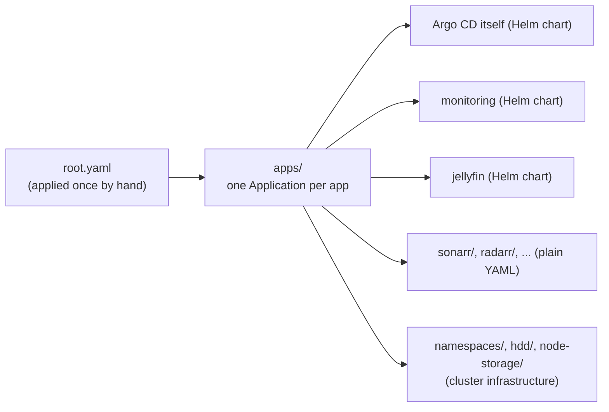

# homelab

My home Kubernetes cluster, running k3s on two machines. Everything in it is deployed by Argo CD from this repo.

Still a work in progress, see the [roadmap](#roadmap).

## Cluster

Two bare-metal nodes running Ubuntu Server: one control plane node and one worker (more planned). A 1 TB external HDD on the control plane node provides persistent storage. For now it's local to that node; the plan is to share it over NFS as more nodes get added. Apps are reached on the home network through the built-in Traefik ingress.

## How it works

Argo CD uses the **app-of-apps** pattern:

- `root.yaml` is the only thing applied by hand. It watches `apps/`.
- Each file in `apps/` is an Argo CD `Application` pointing at either a folder in this repo (plain manifests) or a pinned Helm chart with inline values.
- Cluster infrastructure (namespaces, StorageClasses, PersistentVolumes) is managed the same way as apps.
- Every Application has **automated sync, prune and self-heal**: manual changes in the cluster get reverted to match Git.
- **Argo CD manages itself**: its own Helm release is defined in `apps/argocd.yaml`, so upgrading Argo is a one-line version bump.
- Chart and image versions are pinned, so nothing upgrades unless I change it in Git.

## What's running

| App | What it does |
|-----|--------------|
| Argo CD | GitOps controller (self-managed via Helm) |
| Prometheus + Grafana | Cluster monitoring (kube-prometheus-stack, tuned for k3s) |
| Jellyfin | Media server |
| Sonarr, Radarr, Prowlarr, Seerr | Media library automation |
| qBittorrent | Downloads, with all traffic routed through a Gluetun VPN sidecar |
| whoami | Test app used to verify ingress and load balancing across both nodes |

## Storage

- **External HDD** (`hdd/`): a `local-hdd` StorageClass with hand-written PersistentVolumes pinned to the mini PC. Used for Prometheus data and the shared media library. Data PVs use `Retain` and are annotated so Argo never prunes or deletes them.
- **Node-local storage** (`node-storage/`): a `local-provisioned` StorageClass (k3s local-path provisioner, `Retain`) for small app config volumes, created automatically on whichever node the pod lands on.
- Prometheus deliberately uses local disk, not network storage, to avoid database corruption.

## Backups

- **Velero** (`apps/velero.yaml`, settings in `velero-config/`) takes a daily backup of the media namespace: the Kubernetes objects plus the files in each app's config volume. Backups are encrypted, uploaded to S3 and kept for 30 days.
- Only the node-local config volumes are backed up. The external HDD (media library, Prometheus data) is skipped, and Secrets are left out of backups.
- Uploads are incremental (only changed data is sent), so storage costs pennies a month.
- Restores have been tested: apps came back with their settings intact.
- **Terraform** (`terraform/`) creates the AWS side: a private, encrypted, versioned S3 bucket, an IAM user that can only access that bucket, and a $5/month budget that blocks Velero's access if it's ever exceeded.

## Monitoring and alerts

- Prometheus collects metrics and Grafana shows the dashboards.
- **Alertmanager** sends firing and resolved alerts to a private Discord channel. The webhook comes from a Kubernetes Secret, so it's never stored in Git.
- Alerts use the chart's default rules, plus a custom rule that fires when any media app has been down for 5 minutes.
- Prometheus, Alertmanager and kube-state-metrics are all pinned to the mini PC for now, so alerts still go out if the worker node goes down. Prometheus has to stay on the mini PC anyway because its data is on the HDD, so if the mini PC itself goes down there are no alerts either way.

## Roadmap

- [ ] Friendlier alerts: plain-language rules and email
- [ ] Central logging with Loki, searchable in Grafana
- [ ] Sealed Secrets, so encrypted secrets (VPN, Grafana, Argo, backups, Discord) can live in this repo instead of being created by hand
- [ ] Automated dependency updates with Renovate
- [ ] TLS certificates with cert-manager
- [ ] Remote access to the cluster
- [ ] More nodes
- [ ] Replicated storage with Longhorn, once there are more nodes
- [ ] More services: Uptime Kuma, Pi-hole
